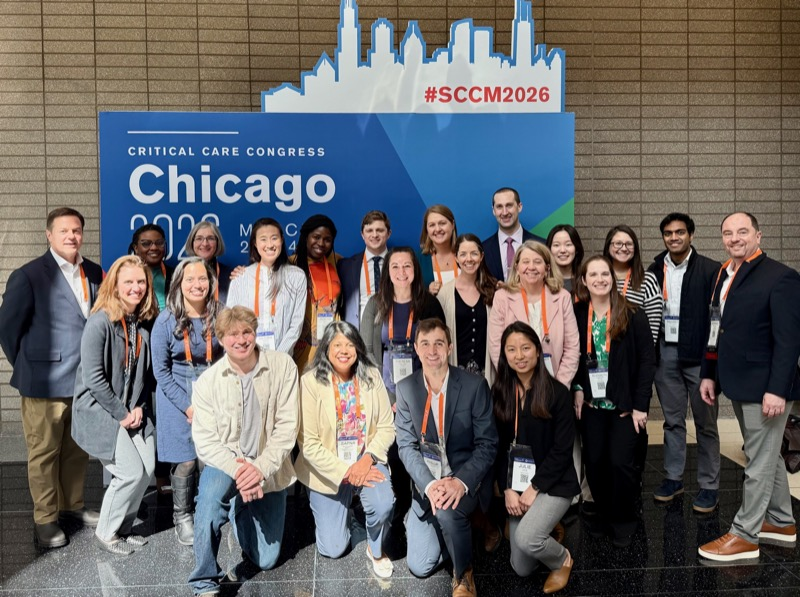
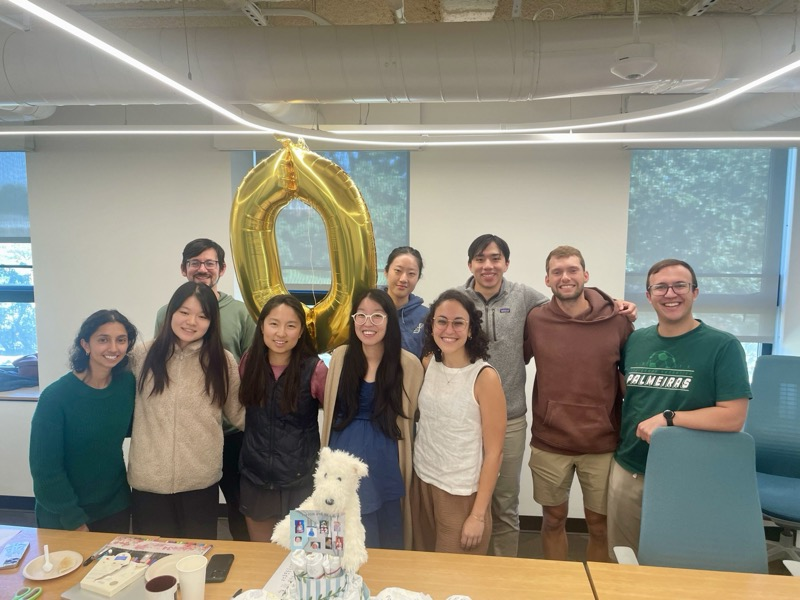
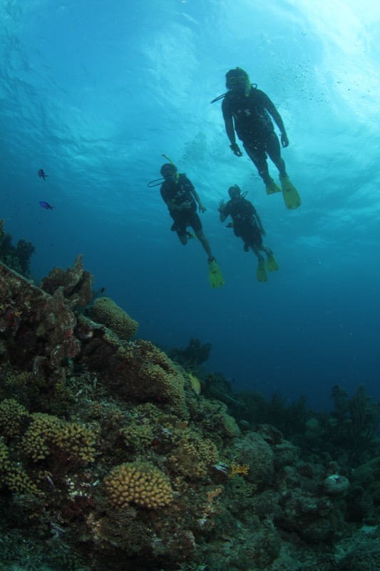
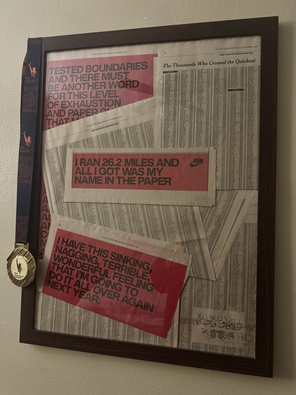
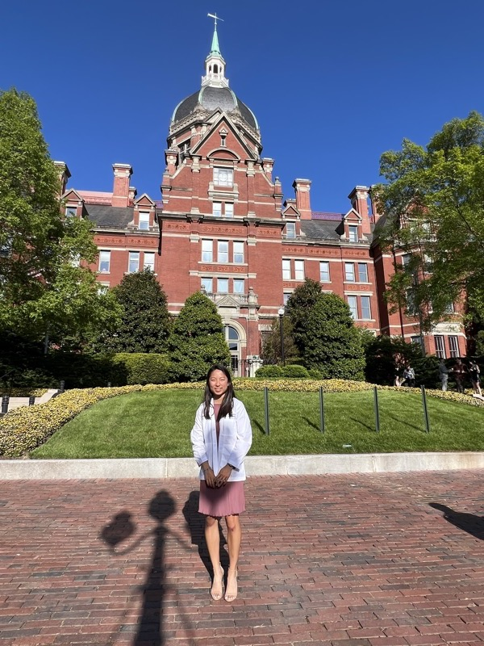
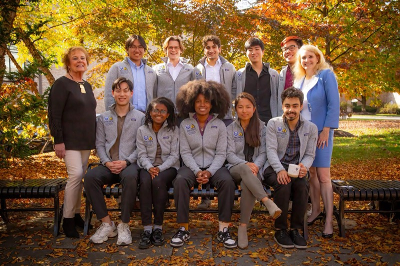

```{=html}
<div class="place-tabs" role="group" aria-label="Choose updates">
  <button type="button" class="place-tab" data-updates="updates-academic" aria-pressed="true">Academic</button>
  <button type="button" class="place-tab" data-updates="updates-snapshots" aria-pressed="false">Snapshots</button>
</div>
```

::: {#updates-academic .dated}
- [Nov 2026]{.when} My [undergraduate mentee]{.hl}, Mayling Chen, received the Johns Hopkins [Provost's Undergraduate Research Award (PURA)]{.hl} fellowship!
- [Sep 2026]{.when} Gave an [oral presentation]{.hl} on longitudinal spatial transcriptomic analyses of cellular niches in immunotherapy-treated gastroesophageal cancer at the [UAD Clinical and Translational Meeting]{.hl} in the Sidney Kimmel Cancer Center at Hopkins.
- [Mar 2026]{.when} Presented our work on epigenetic biomarkers of brain injury in children on ECMO as an [oral presentation]{.hl} at the [Society of Critical Care Medicine Critical Care Congress]{.hl} in Chicago.
- [Jan 2026]{.when} Joined the [JEFworks]{.hl} lab!
- [Dec 2025]{.when} Gave an [oral presentation]{.hl} on our ECMO efforts at the [Johns Hopkins Anesthesiology and Critical Care Medicine 2025 Research Day Symposium]{.hl}.
- [2025]{.when} Named a [finalist]{.hl} for the Paul & Daisy Soros Fellowships for New Americans.
- [Apr 2024]{.when} Gave a [platform presentation]{.hl} at the [American Academy of Neurology Annual Meeting]{.hl} in Denver, and received the [AAN Medical Student Experience fellowship]{.hl}!
- [Aug 2023]{.when} Started the [MD/PhD]{.hl} program in the Johns Hopkins Medical Scientist Training Program!
:::

::: {#updates-snapshots hidden=""}
```{=html}
<div class="snapshots">
  <div class="snap-row">
    <figure class="snap" tabindex="0" style="--ar: 1.340">
      
      <figcaption>Presented our work on epigenetic biomarkers of brain injury in children on ECMO at the Society of Critical Care Medicine Critical Care Congress in Chicago. Honored to be part of the Johns Hopkins Critical Care team. (Mar 2026)</figcaption>
    </figure>
  </div>
  <div class="snap-row">
    <figure class="snap" tabindex="0" style="--ar: 1.333">
      
      <figcaption>Joined the JEFworks lab and launched this website during my first lab sabbatical with the team! (Jan 2026–)</figcaption>
    </figure>
    <figure class="snap" tabindex="0" style="--ar: 0.666">
      
      <figcaption>PADI Scuba Diver certified! (Dec 2025)</figcaption>
    </figure>
  </div>
  <div class="snap-row">
    <figure class="snap" tabindex="0" style="--ar: 0.750">
      
      <figcaption>Ran the 2025 TCS New York City Marathon! Maybe the only time my name will appear in the New York Times. (Nov 2025)</figcaption>
    </figure>
    <figure class="snap" tabindex="0" style="--ar: 0.750">
      
      <figcaption>Johns Hopkins University School of Medicine White Coat Ceremony. (April 2024)</figcaption>
    </figure>
  </div>
  <div class="snap-row">
    <figure class="snap" tabindex="0" style="--ar: 1.501">
      
      <figcaption>Started the MD/PhD program at the Johns Hopkins Medical Scientist Training Program! Looking forward to all that is to come. (Aug 2023–)</figcaption>
    </figure>
  </div>
</div>
```
:::

```{=html}
<script>
document.addEventListener("DOMContentLoaded", function () {
  var tabs = document.querySelectorAll("[data-updates]");
  tabs.forEach(function (t) {
    t.addEventListener("click", function () {
      tabs.forEach(function (o) {
        var on = o === t;
        o.setAttribute("aria-pressed", on ? "true" : "false");
        o.classList.toggle("is-active", on);
        document.getElementById(o.getAttribute("data-updates")).hidden = !on;
      });
    });
  });
  tabs[0].classList.add("is-active");
});
</script>
```
